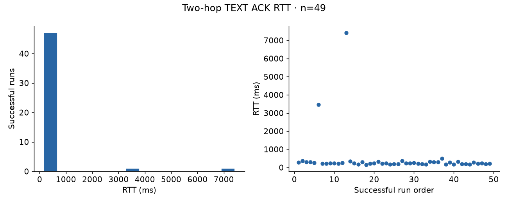
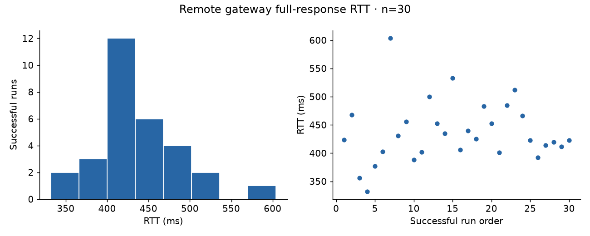
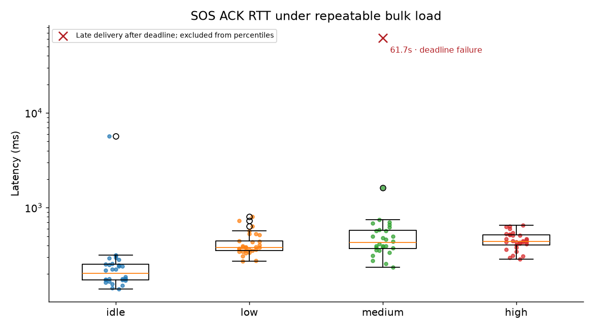
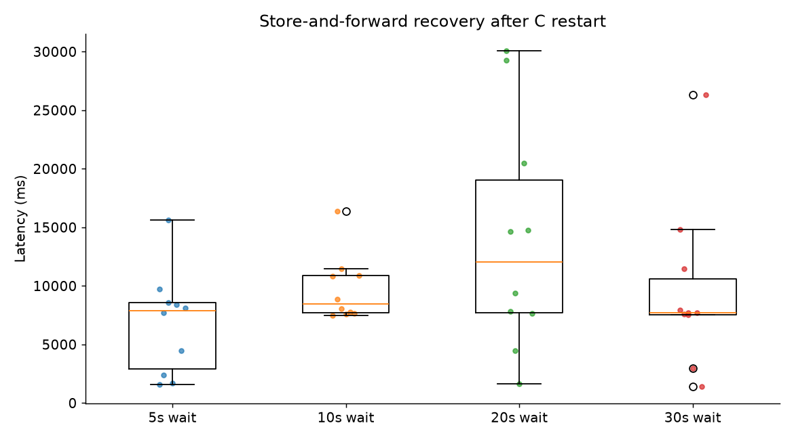
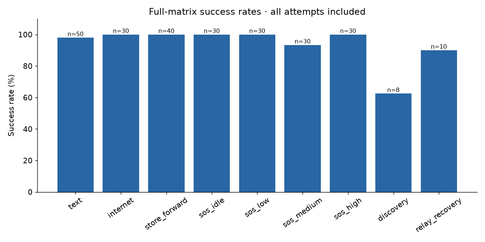
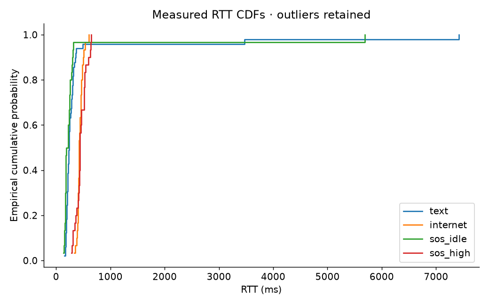

# MeshMind 3-Phone Physical Benchmark

Session: `physical_20261006_01`. Report generated 2026-10-07T02:01:51.912323+05:30.

## Hardware

| Role | User-supplied phone label | Detected model | Android | ADB | Node |
|---|---|---|---|---|---|
| A | OnePlus 12R | CPH2585 | 16 | USB `ac7626fb` | `A-fbd6` |
| B | Realme 12 Pro (user label; model identifier is authoritative) | RMX5108 | 16 | wireless `192.168.29.70:41549` | `B-e84d` |
| C | Samsung Galaxy S24 Ultra | SM-S928B | 16 | wireless `adb-RZCY91EJ4ET-0L9Aed._adb-tls-connect._tcp` | `C-507b` |

## Topology

A ↔ B ↔ C. The topology is software-enforced using the existing Nearby peer filter/topology lock. Disallowed A↔C application links are rejected; this is **not physical RF isolation**.

Preflight passed: `True`. Every delivered measured packet requires matching full-UUID relay receive/send logs, a two-hop destination route, and matching reverse ACK evidence (or Internet response evidence).

## Build / Test Conditions

APK SHA-256: `190e24e22253bdb430d4ee2ba15760248796440ec3e9edc3263e35aae8e949fe`. Version 0.1.0 / code 1; debug-only shell-permission control receiver added. Production routing, persistence, priority and transport code unchanged.

The harness never changes radios. B and C retain Wi-Fi for wireless ADB; A remains controlled over USB. A began preflight with Wi-Fi enabled and was later observed with airplane mode on and Wi-Fi off. Per-attempt radio observations are captured in full runs. Bluetooth remains available. Outages stop only MeshMind, never the radio. Nearby P2P_CLUSTER chooses the available bearer; results do not establish Bluetooth-only performance. Existing non-disruptive Wi-Fi upgrade policy retained.

Only C has gateway consent. INET_REQUEST follows the remote app path A→B→C. The smoke gateway attempt had validated Internet on A; all five mini gateway attempts reported no validated Internet on A. Full runs record A radio, airplane and validated state separately. Remote gatewaying is proven; do not infer isolation for a sample without its radio evidence. Endpoint is always https://example.com/. Gateway cadence is ≥11 seconds to respect 6 requests/minute.

The harness observes snapshots and logs through ADB and saves complete raw observations. Snapshot polling and durable Room writes are part of the instrumented test conditions. Logcat is continuously captured on all phones for MeshMind plus fatal AndroidRuntime errors; structured app logs accompany each command.

## Method

Stages: preflight → one smoke attempt per scenario → five mini attempts per scenario → inspect → full matrix. Warmups are retained and excluded from full measured summaries. All attempts, including failed infrastructure attempts, remain in JSONL/CSV. No failures are replaced. Success denominators include every full attempt; latency distributions use successful valid attempts only.

Percentiles use Python statistics.quantiles with the inclusive method, equivalent to Hyndman–Fan type 7 linear interpolation at (n−1)p. Standard deviation is population standard deviation. P99 is descriptive and unstable below 100 samples; no statistical significance is claimed. Primary RTT uses source app enqueue and final ACK times on A; Internet RTT uses full-response acceptance on A. Store recovery uses C restore and C delivery, both on C. Relay recovery uses B restore and queued packet forwarding, both on B. Cross-device times are preserved but not presented as precise one-way latencies. Each snapshot records a host/device offset estimate and its round-trip uncertainty.

Store outage buckets (5/10/20/30s) describe the deliberate wait after B retains the packet. Actual absence, including loss detection and queue confirmation, is separately recorded. Discovery latency starts at A's start command and includes subsequent B/C starts, ending when A learns C via B; a subsequent text+ACK validates route usability.

SOS load levels use repeatable 128KiB/512KiB/1MiB LOW transfers (8/32/64 chunks of 16KiB). SOS is queued immediately after transfer creation through unchanged APIs. Pending chunks at injection, source completion after SOS ACK, destination SOS before bulk completion, and destination SHA-256 are required. Queued-byte values are payload estimates (chunk count ×16KiB), excluding wire headers. Queue depth at a later polling observation is not an exact depth at SOS delivery.

## Results

| Test / outage | Attempts | Success | p50 ms | p90 ms | p95 ms | p99 ms† | Mean ms | Min ms | Max ms | Std ms |
|---|---:|---:|---:|---:|---:|---:|---:|---:|---:|---:|
| text | 50 | 49/50 | 238.0 | 352.6 | 443.8 | 5525.7 | 460.1 | 151.0 | 7426.0 | 1105.5 |
| internet | 30 | 30/30 | 424.5 | 501.2 | 523.5 | 583.4 | 437.2 | 332.0 | 604.0 | 53.6 |
| store_forward / 5s | 10 | 10/10 | 7909.0 | 10302.4 | 12954.7 | 15076.5 | 6832.7 | 1592.0 | 15607.0 | 4152.9 |
| store_forward / 10s | 10 | 10/10 | 8472.5 | 11959.9 | 14164.5 | 15928.1 | 9701.2 | 7464.0 | 16369.0 | 2662.0 |
| store_forward / 20s | 10 | 10/10 | 12020.5 | 29351.8 | 29710.9 | 29998.2 | 14026.7 | 1627.0 | 30070.0 | 9366.2 |
| store_forward / 30s | 10 | 10/10 | 7697.0 | 15955.4 | 21150.2 | 25306.0 | 9551.6 | 1398.0 | 26345.0 | 6633.9 |
| sos_idle | 30 | 30/30 | 202.0 | 298.5 | 313.6 | 4127.7 | 394.9 | 138.0 | 5685.0 | 983.7 |
| sos_low | 30 | 30/30 | 381.5 | 579.3 | 685.5 | 780.0 | 424.3 | 273.0 | 802.0 | 123.1 |
| sos_medium | 30 | 28/30 | 427.5 | 692.6 | 729.6 | 1388.1 | 500.4 | 234.0 | 1626.0 | 256.1 |
| sos_high | 30 | 30/30 | 439.5 | 598.3 | 632.4 | 645.9 | 453.8 | 286.0 | 650.0 | 96.3 |
| discovery | 8 | 5/8 | 70308.0 | 72065.8 | 72305.4 | 72497.1 | 60008.4 | 20647.0 | 72545.0 | 19839.5 |
| relay_recovery | 10 | 9/10 | 21699.0 | 47929.6 | 48748.8 | 49404.2 | 30768.2 | 11941.0 | 49568.0 | 14036.4 |

† P99 is unstable at these sample sizes. See benchmark_summary.csv for separate overall RTT and recovery distributions and HTTP execution times.

## Stage audit

| Stage | Attempts | Passed | Failed |
|---|---:|---:|---:|
| full | 258 | 251 | 7 |
| mini | 45 | 45 | 0 |
| smoke | 9 | 9 | 0 |
| warmup | 30 | 30 | 0 |

## Failures and outliers

- full text #40: **TEST_INFRASTRUCTURE** — ADB ['-s', 'adb-RZCY91EJ4ET-0L9Aed._adb-tls-connect._tcp', 'shell', 'am', 'broadcast', '-n', 'dev.meshmind.app/.benchmark.BenchmarkReceiver', '--es', 'token', 'b9487f1d052df4d849e594bc4ef5881fb', '--es', 'command', 'snapshot']: adb.exe: device offline (`parsed/full_text_40_d328f1.json`).
- full sos_medium #16: **MESHMIND_SYSTEM** — Timed out after 60s waiting on A (`parsed/full_sos_medium_16_7318b1.json`).
- full sos_medium #17: **TEST_INFRASTRUCTURE** — Required evidence absent (`parsed/full_sos_medium_17_a7b56d.json`).
- full discovery #1: **MESHMIND_SYSTEM** — No instrumentation response: C start; Broadcasting: Intent { flg=0x400000 cmp=dev.meshmind.app/.benchmark.BenchmarkReceiver (has extras) }
Broadcast completed: result=0;  (`parsed/full_discovery_1_700106.json`).
- full discovery #2: **MESHMIND_SYSTEM** — Topology not established: {'A': [{'bytesSent': 8124, 'connectedAt': 1791316904804, 'endpointId': 'RWLM', 'framesSent': 2, 'nodeId': 'B-e84d', 'queued': 0}], 'B': [{'bytesSent': 544188, 'connectedAt': 1791316904102, 'endpointId': 'V8P2', 'framesSent': 3774, 'nodeId': 'A-fbd6', 'queued': 0}], 'C': None} (`parsed/full_discovery_2_af59ef.json`).
- full discovery #3: **TEST_INFRASTRUCTURE** — Operator interrupted precondition polling after repeated C heap crash to avoid more invalid restarts; no measured probe enqueued (`parsed/full_discovery_3_a17d02.json`).
- full relay_recovery #9: **MESHMIND_SYSTEM** — Timed out after 120s waiting on A (`parsed/full_relay_recovery_9_d91a22.json`).

Largest successful total latency: discovery #6, 72545ms. Store/relay runs include intentional outage time.

## Claims discipline

**VALIDATED:** Only the physical attempts actually recorded in this session (258 full-matrix attempts so far). Detailed per-packet evidence is in parsed run JSON files.

**SOFTWARE-ENFORCED:** Two-hop A–B–C application topology and rejection of direct A–C links. All phones are in the same test environment.

**SIMULATED:** No simulated measurements included in these tables. Existing JVM tests are functional checks, not physical evidence.

**NOT TESTED:** Event-scale operation, 20,000 phones, emergency guarantees, RF isolation, field range, battery longevity, Bluetooth-only performance, Internet isolation at the OS level, simultaneous mixed-traffic suite, single-hop comparison, or statistical significance.

## Artifacts

Session directory: `sessions/physical_20261006_01/`. `raw/`: logcat, dumpsys, command observations. `parsed/`: per-attempt evidence, CSVs. `plots/`: distributions, visible outliers and success rates. Original JSONL is append-only. Tests with missing measurements are shown as untested, never filled from earlier demos.

## Interpretation of the physical results

Medium-load SOS #16 exceeded the 60-second deadline, then automatically delivered at **61705ms**. Failed A↔B sends preceded recovery. This remains a MESHMIND_SYSTEM failure, is excluded from successful-latency percentiles, and is plotted explicitly as a late-delivery failure. It is the largest observed SOS latency, not a lost or manually resent packet.

Medium-load #17 remains a failed/invalid collection attempt. The collector read an early C snapshot before the new transfer appeared; residual traffic from #16 also raised its pending load to 49 chunks instead of 32. Its failure class is audited as TEST_INFRASTRUCTURE, with original MESHMIND_SYSTEM classification retained in JSONL and an explicit classification audit. No attempt or failure is deleted.

Text attempt #40 remains a TEST_INFRASTRUCTURE failure and is excluded from the primary distribution. A later observation verified the original packet's full A→B→C delivery and C→B→A ACK at 354ms, without resending it. Thus the original physical text packets were delivered, while strict collection validity is 49/50. See `parsed/text_40_posthoc_audit.json`.

Relay recovery #9 failed its 120-second deadline, then the original packet automatically delivered with a complete two-hop path and matching reverse ACK at **154055ms** RTT. An earlier B snapshot preserves its forwarding/ACK evidence before the next controlled B outage. This remains a MESHMIND_SYSTEM failure and is excluded from successful percentiles. See `parsed/relay_9_posthoc_audit.json`.

Observed direct-link refusal evidence consists of both endpoints logging ‘not linking … (topology lock)’. The incoming rejectConnection branch was inspected in code but was not forced separately.

| SOS condition | Delivered / attempted | p50 ms | p95 ms |
|---|---:|---:|---:|
| idle | 30/30 | 202.0 | 313.6 |
| low | 30/30 | 381.5 | 685.5 |
| medium | 28/30 | 427.5 | 729.6 |
| high | 30/30 | 439.5 | 632.4 |

Heavy-load SOS p95 is 632.4ms versus idle 313.6ms, difference 318.8ms (2.02×). This is a descriptive comparison, without a statistical significance test.

| Store queue-wait bucket | Recovered / attempted | Recovery p50 ms | Recovery p95 ms | Recovery max ms | Total RTT p50 ms | Total RTT p95 ms |
|---|---:|---:|---:|---:|---:|---:|
| 5s | 10/10 | 7909.0 | 12954.7 | 15607.0 | 14631.0 | 19459.5 |
| 10s | 10/10 | 8472.5 | 14164.5 | 16369.0 | 20621.5 | 26035.0 |
| 20s | 10/10 | 12020.5 | 29710.9 | 30070.0 | 33972.5 | 51298.6 |
| 30s | 10/10 | 7697.0 | 21150.2 | 26345.0 | 39648.5 | 53863.2 |

Pooled store-and-forward recovery: 40/40, p50 7999.0ms, p95 26491.3ms. All recorded failures remain in the denominator.

### Answers for the pitch and validation review

1. Strongest validated result: heavy-load critical traffic followed the enforced two-hop path while a 1MiB LOW transfer was pending, and the bulk bytes were verified by SHA-256 afterward (30/30).
2. Worst observed failure: C crashed with OutOfMemoryError at its 256MiB heap limit while Room loaded accumulated packets during a warm mesh restart. A fresh process restored service, but warm restart under this history remains unvalidated.
3. Largest successful latency: discovery #6, 72545ms. Intentional outages are included where applicable. Largest observed packet RTT including deadline failures: relay #9, 154055ms. This late failure does not enter the successful percentiles. Largest SOS RTT including failures: 61705ms, also excluded.
4. SOS preemption: 88/90 loaded attempts satisfied delivery, reverse ACK, SOS-before-bulk order, bulk continuation and byte integrity; high-load p95 632.4ms. Reliability here is limited to these controlled queued-load experiments; SOS is injected immediately after bulk enqueue, not at a random point in a long-running transfer.
5. Store-forward reliability: 40/40 recovered with automatic app reconnection and no manual resend; recovery p95 26491.3ms.
6. A–B–C evidence: all 251 successful full attempts required the expected route and matching relay evidence. Failed attempts do not acquire a route claim.
7. Brochure wording supported by these conditions: ‘Validated on three physical Android phones under a software-enforced two-hop topology. Critical SOS delivery during a queued 1MiB transfer: 30/30, p95 632.4ms; the bulk transfer subsequently completed with verified bytes.’ Avoid claims of emergency guarantees or large-event scale.

### Restart stress and changed procedure

After the bulk matrix, C's warm mesh restart crashed while Room loaded persisted packets: OutOfMemoryError at the 256MiB heap limit. The next attempt could not form the topology; a third precondition attempt was interrupted to avoid more invalid restarts. Original attempts and crash logs are retained. C recovered after force-stopping only MeshMind and launching a fresh process. App data, identity, peer filters and radio settings were preserved.

Discovery was responsibly reduced from 20 planned repetitions to five measured cold-process runs. Cold discovery: 5/5, p50 70308.0ms, p95 72305.4ms. The aggregate discovery row includes the two failed warm attempts and one interrupted precondition attempt; their outcomes are not erased or mixed into the successful cold timing distribution.

For cold discovery, all three app processes are force-stopped and opened before the existing mesh-start APIs run. For relay recovery, only B's process is stopped/reopened. These are controlled app outages; Wi-Fi and Bluetooth are not toggled, and Room data is not cleared. The cold workaround does not fix or validate warm restart under accumulated bulk history.

Adjusted expected attempt counts: `{'text': 50, 'internet': 30, 'store_forward': 40, 'sos_idle': 30, 'sos_low': 30, 'sos_medium': 30, 'sos_high': 30, 'discovery': 8, 'relay_recovery': 10}`. Original requested counts remain below for comparison.

Suites ran serially, and persisted packet history was retained and grew. Conditions are not randomized/reset between load levels. The restart results therefore apply to this accumulated-history session, not a pristine installation. The early-snapshot and failed-bulk-drain harness fixes are available for future sessions; original measurements from this session remain intact.

Relay recovery was capped at 10 total attempts by the user's explicit instruction. Result: 9/10; failures remain in the denominator. This replaces the original 20-run target for this session.

### Completeness and measurement limits

Full matrix attempt counts: `{'text': 50, 'internet': 30, 'store_forward': 40, 'sos_idle': 30, 'sos_low': 30, 'sos_medium': 30, 'sos_high': 30, 'discovery': 8, 'relay_recovery': 10}`. Required counts: `{'text': 50, 'internet': 30, 'store_forward': 40, 'sos_idle': 30, 'sos_low': 30, 'sos_medium': 30, 'sos_high': 30, 'discovery': 20, 'relay_recovery': 20}`.

Exact HTTP socket duration and exact queue depth at the instant of C's SOS delivery are unavailable from the unchanged app. The HTTP duration is C's gateway execution interval (including policy/executor work); queue snapshots at injection and after polling are preserved. ACK creation is not independently logged; C's matching ACK send is recorded. Route availability is confirmed through handshakes and a delivered probe, not a separately exposed route-usability callback.

Legacy `loss_detection_ms` in early smoke/mini records subtracts different device clocks and must not be interpreted as latency. `benchmark_timelines.csv` reconstructs `loss_detection_host_ms` from the raw host observations for every outage; full runs use that corrected field. Primary RTT/recovery metrics were already measured on one phone's clock and are unaffected.

Timeline CSV columns name their observing phone; cross-device absolute timestamps must not be subtracted without accounting for recorded clock offsets and uncertainty. No fake timing samples are included.

## Plots

## Final device state

Read-only verification at 2026-10-07T01:58:01.815501+05:30: B and C Wi-Fi remained enabled and connected; wireless ADB remained reachable. All phones had Bluetooth enabled and the same APK hash. A remained USB-connected with its externally observed Wi-Fi-off/airplane-on state unchanged. Live peer sets were A→B, B→A+C, C→B. See `raw/final_conditions.json`. Owned benchmark/logcat collectors were stopped after collection.

